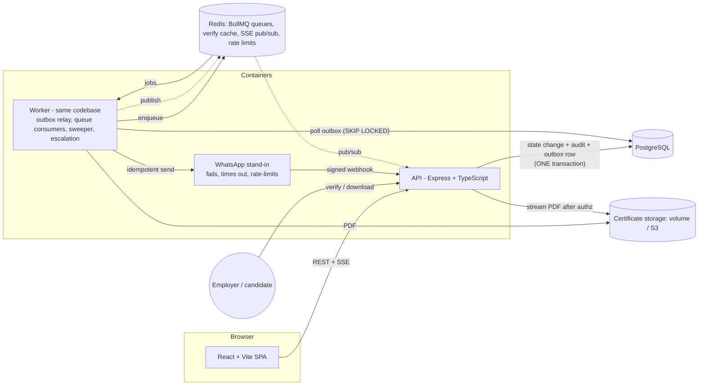

# CertiFlow - skilling certificate issuance platform

One platform that decides **who gets certified**, **issues the certificate**, and lets **anyone check that it is genuine** - built for the (fictional) Pragati Skills Mission: ~8,000 trainees a month, 300+ private training centres.

> **Run it:** `docker compose up --build` -> open <http://localhost:8080> and pick a persona.
> **Test it:** `docker compose --profile test run --rm test` (or `cd server && npm test`). Full guide: [SETUP.md](SETUP.md).
> **Deploy it:** plan, load maths, costs and failure handling in [DEPLOYMENT.md](DEPLOYMENT.md).
> **Read this first if you review the code:** [docs/WALKTHROUGH.md](docs/WALKTHROUGH.md) (file map + the questions you are likely to ask) and [docs/KNOWN_ISSUES.md](docs/KNOWN_ISSUES.md) (honest limits).

---

## 1. Requirements note (what I understood, and what I decided where the brief was vague)

### The problem in one paragraph
Today centres email spreadsheets, officers approve over WhatsApp and a clerk types certificates in Word. That means weeks of delay, no audit trail, and forgeable certificates. The platform must take a **batch of passed candidates** from a centre, push it through a **multi-step approval**, issue **one certificate per candidate**, put it on the **candidate's phone**, and let **employers verify it without logging in** - while making sure the wrong people can never act, nothing is issued twice, and every decision is traceable.

### Who does what

| Persona (demo user) | Role | Can do | Can never do |
|---|---|---|---|
| Training centre (**Anika**; Rohan for isolation tests) | `centre` | Create batch, upload spreadsheet, send for approval, see status, fix and resend | See other centres' batches; decide anything |
| District officers (**Dev, Meera, Kabir**; Sunita in another district) | `district_officer` | Review their district's batches, approve / reject / send back (with reason), correct a typo | See other districts; approve alone; vote twice |
| Quality team (**Neha**) | `quality` | Second-level review of **large** batches (>= 50 candidates) | Review small batches; skip ahead |
| State office (**Farah**) | `state` | Final approval, see what's stuck, cancel a certificate, re-queue failed deliveries | Approve at a step that isn't theirs (separation of duties) |
| Candidate | no login | Receive certificate on WhatsApp, download it with a private link | See anyone else's certificate |
| Employer / public | no login | Verify a certificate number (or scan the QR) | See phone, email, score, batch |

### The flow
```
Centre: create batch -> upload CSV/XLSX (all-or-nothing) -> send for approval
   DISTRICT_REVIEW  (needs 2 DIFFERENT officers to agree)
        | large batch? (>= 50)            \  send back (1 officer + reason)  -> CHANGES_REQUESTED -> centre fixes -> resend (new round)
   QUALITY_REVIEW  (1 person)             /  reject (quorum) -> REJECTED (final)
        |
   STATE_REVIEW    (1 person, final say)
        |
   APPROVED -> one certificate per candidate -> PDF + QR -> WhatsApp -> candidate downloads / employer verifies
                                                       state office can CANCEL any certificate at any time
```

### Decisions where the brief was vague (full reasoning in [docs/DECISIONS.md](docs/DECISIONS.md))

| # | Question the brief left open | My decision |
|---|---|---|
| D-1 | "More than one officer must agree" - how many? | **2 distinct district officers** for approve; same for reject. Configurable, never below 2. |
| D-2 | What is a "big batch"? | **>= 50 candidates** goes through the quality team. Configurable. |
| D-4 | One officer approves, another rejects? | Stays pending; a third officer breaks the tie. **Sending back needs only one officer** (it is reversible and cautious). |
| D-5 | Can the state office approve at district level to unblock things? | **No.** Separation of duties: they see stuck items and are alerted, but only decide at their own step. |
| **D-6** | **What happens to approvals a batch already had when it is sent back, fixed and resent?** | **They are void. A resubmission starts a new review round from the district; old votes stay in history but no longer count.** Reason: an approval means "I approved *this* data"; the data changed. The same rule applies if an officer corrects a typo mid-review. The audit trail records exactly how many approvals were voided. |
| D-7 | Partly bad spreadsheet? | **Nothing is saved**; every problem is reported with row + column. The spreadsheet is the source of truth (re-import replaces the draft list). |
| D-8 | What is "a candidate getting two certificates"? | Enforced three ways in the **database**: one certificate per candidate row, unique numbers, and one **active** certificate per (person, course) across batches. |
| D-10 | WhatsApp is unreliable - what does "exactly one" mean? | Retries are **at-least-once**, but every send carries an **idempotency key**, so the provider can never produce a second message for the same certificate. Retry budget ~4 h, then dead-letter + alert + manual re-queue. |
| D-12 | What may the public see when verifying? | Holder name, course, centre, issue date. **Never** phone, email, score, batch, cancel reason. |
| D-13 | "Too long" for escalation? | **24 h** -> reminder to officers who still owe a vote + heads-up to state office; **48 h** -> URGENT to state office. Exactly once per level. Configurable. |

### Assumptions
Indian mobile numbers (+91, 10 digits); the pass mark is per course; WhatsApp messages go through a provider API (stand-in here); certificates are PDFs with a QR code and a tamper-evident number (`CF-2026-100245-K7QM`: sequence + HMAC check code).

---

## 2. How the system is put together



**Event flow for the money path (batch approved -> candidate has a certificate):**
1. Final approval runs in **one DB transaction**: lock batch row -> record vote -> advance status -> create one `PENDING` certificate per candidate -> write audit row -> write `batch.approved` **outbox** row. Commit. The user gets an instant response; nothing slow happens in the request.
2. The **outbox relay** (worker) moves the row to a BullMQ queue. The `batch.approved` handler fans out one `generate` job per certificate.
3. `generate` renders the PDF (+QR), stores it, marks the certificate `ISSUED`, creates the **single** delivery row and emits `certificate.issued`.
4. `send` claims the delivery atomically, calls WhatsApp with `Idempotency-Key = delivery id`. Success -> `SENT`; timeout/5xx/429 -> `RETRY` with exponential backoff + jitter; permanent error -> `FAILED_PERMANENT`; budget exhausted -> `DEAD` (alert + one-click re-queue). A signed webhook later flips `SENT` -> `DELIVERED`.
5. A **sweeper** re-derives outstanding work from Postgres every 15 s (stale claims, PENDING certificates, due retries, escalations), so **losing Redis loses nothing but a few seconds**.
6. Every step publishes an event on Redis pub/sub; the API streams it over **SSE** to the right browsers, which refetch. No page refresh anywhere.

### Key technical decisions (and why)

| Area | Choice | Why - and what I rejected |
|---|---|---|
| Truth lives in | **PostgreSQL** (not Redis) | Redis is only a *hint that work exists*. Queues, cache and pub/sub can all vanish without losing a decision. |
| Correctness under concurrency | `SELECT ... FOR UPDATE` on the batch + `UNIQUE(batch, round, stage, officer)` + counting and advancing in the **same** transaction | Two officers approving "at the same moment" serialise on the row lock; the second sees the first's vote and reaches quorum; the third finds the batch already moved (409). Tested 25x in a loop, and by **deleting the lock and watching the tests fail**. Rejected: optimistic version columns (retry storms), Redis locks (a second source of truth). |
| Events | **Transactional outbox** + BullMQ | "State changed but event lost" is impossible by construction. Rejected: publishing to the queue inside the request (dual-write problem). |
| Queue | **BullMQ on Redis** | Redis is already needed for cache + pub/sub; BullMQ gives delays, concurrency, jobId dedupe. ~30k jobs/hour is small. Rejected: RabbitMQ/Kafka/SQS (more infrastructure with no benefit at this volume - see DEPLOYMENT.md for when I would switch). |
| ORM / migrations | **Drizzle** + SQL migrations (incl. a hand-written migration for triggers) | Thin, close to SQL, partial unique indexes and `FOR UPDATE` are first-class. Rejected: Prisma (heavier, row locking and partial indexes need raw SQL anyway). |
| Safety rules | Enforced **in the database** (unique indexes, CHECKs, append-only audit trigger, no-reinstate trigger) | A bug in application code still cannot create a duplicate certificate, rewrite history or revive a cancelled certificate. Each has a test that attacks the DB directly. |
| Live updates | **Server-Sent Events** + one-time ticket | One-way, works through proxies, auto-reconnect. Rejected: WebSockets (two-way not needed). Events carry **ids only** - the browser refetches through normal authorised APIs, so the stream cannot leak data. |
| Verification speed vs. correctness | Redis cache (60 s) + **revocation tombstone** checked on every read + `Cache-Control: no-store` + check-code that rejects typos/scans without touching the DB | A cancel can never be hidden by the cache. Tested with a hammer loop running *during* a cancel. |
| Auth | Short-lived JWT carrying only the user id; user **re-loaded from DB each request**; scope checks next to the data | Deactivating a user or changing scope takes effect immediately. Out-of-scope objects return **404**, not 403 (no existence leak). |
| Frontend | React + Vite + TypeScript, TanStack Query, Tailwind | No state library, no component kit - nothing included "to tick a box". |
| WhatsApp | **Own stand-in service** (`whatsapp-sim`) | Dedupes by idempotency key; can 500, 429, go down, or *accept-then-timeout* (the nasty ambiguous case). Controllable from a web page during the demo. |

---

## 3. What is in the repo

```
server/            Express + TypeScript API *and* worker (one codebase, two entry points)
  src/domain/        pure rules: workflow state machine, CSV validation, certificate numbers
  src/services/      batches, approvals (the locked transaction), certificates, deliveries, verify, escalation, ...
  src/jobs/          outbox relay, queue handlers, sweeper
  src/http/          routes, validation, rate limiting, SSE
  drizzle/           SQL migrations (0000 schema, 0001 DB-level guards)
  test/              74 tests - see below
whatsapp-sim/      the unreliable WhatsApp provider stand-in (+ phone-view web page)
web/               React SPA (+ nginx config that proxies /api and disables buffering for SSE)
docker-compose.yml one-command start;  Makefile;  samples/ (good, large, and deliberately bad spreadsheets)
docs/              DECISIONS, WALKTHROUGH, KNOWN_ISSUES, AI_USAGE, DEMO_SCRIPT, evidence/
```

## 4. Tests - what they prove

`server/test` runs against **real PostgreSQL and Redis**, a **real BullMQ worker** and the **real hostile WhatsApp stand-in** (no mocks of the things that matter).

| File | Proves |
|---|---|
| `moment1_import` | Bad rows -> exact `row:column:code` errors, **nothing saved** (also for `.xlsx`); cross-batch duplicates blocked |
| `moment2_concurrency` | Simultaneous approvals advance **once** (25 rounds), 3-way race = 2 winners + clean 409, double-click counts once, final approval creates certificates once |
| `moment3_delivery` | 60 certificates through 30 % errors + 15 % accept-then-timeout + 10 % 429: **60 certs, 60 unique numbers, 60 messages, one per phone**; outage recovery; dead-letter + re-queue; Redis wiped + worker killed; abandoned claim reclaimed; signed webhooks |
| `moment4_cancel_verify` | Cancel -> next verify says CANCELLED, even with a hammer loop running during the cancel and with the cache wiped |
| `moment5_escalation` | After SLA the right people are told **exactly once**, even with 5 schedulers racing; level 2 urgent; state sees stuck list |
| `moment6_sendback` | Reason mandatory; resubmission = new round; **old approvals void**; officer correction voids votes; audit records it |
| `never_happen` | Rules 1-5: wrong step / forged identity / forged tokens; duplicate certificates & numbers (attacked **directly in SQL**); cancelled never genuine (DB trigger); strangers get nothing (IDOR, token, PII keys); every decision traceable & audit log append-only |
| `security` | Malformed/oversized input, non-UUID ids, SQL/HTML text, mass assignment, formula injection, login rate-limit, headers |
| `realtime` | SSE events reach exactly the right people; tickets are one-time |
| `unit` | State-machine rules, check-code, spreadsheet validator |

**Evidence that the tests are not decorative** ([docs/evidence/mutation-check.md](docs/evidence/mutation-check.md)): removing `FOR UPDATE` makes the concurrency tests fail; the browser walk-through found a real bug the tests missed (SSE route blocked by auth) which now has tests.

## 5. Honest limits
Short version (full list in [docs/KNOWN_ISSUES.md](docs/KNOWN_ISSUES.md)): the Compose stack was **validated but not executed** in the sandbox this was written in (no Docker daemon there) - the app and every build step were run natively; the audit log is append-only but not hash-chained; stuck batches can be seen and escalated but not re-assigned; load numbers are measured on one small box and extrapolated.

## 6. AI usage
Built with Claude (Claude Code). What it did, how output was checked, and what I personally reviewed: [docs/AI_USAGE.md](docs/AI_USAGE.md).
